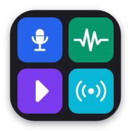
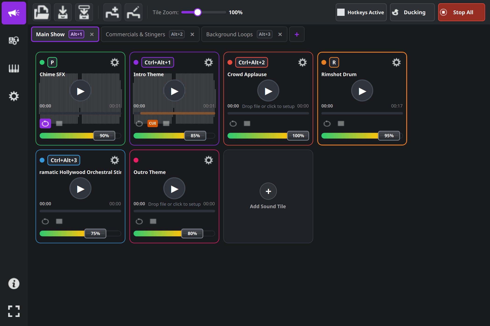
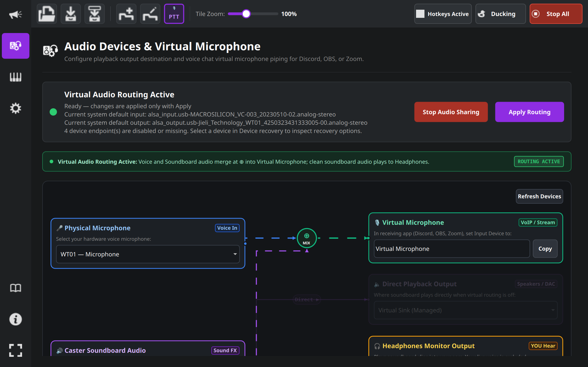
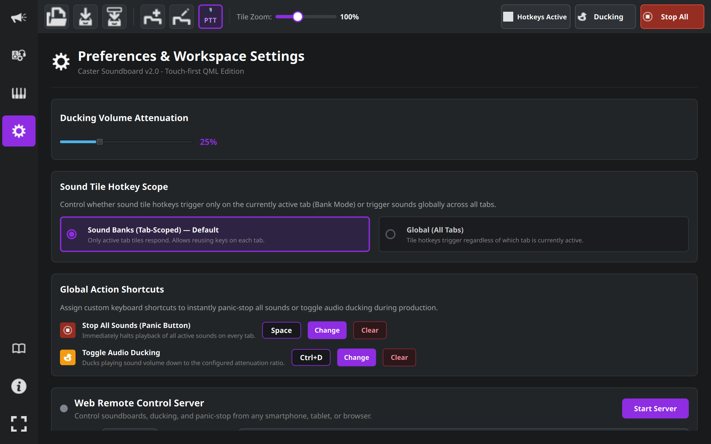

# Caster Soundboard

<p align="center">
  
</p>

<p align="center">
  <b>A modern, touch-first soundboard designed for podcasters, live streamers, broadcasters, and tabletop gamers.</b>
</p>

<p align="center">
  <a href="LICENSE"></a>
  
  
  
</p>

---

## Overview

**Caster Soundboard** is a fast, tactile audio playback tool engineered for live broadcast environments. Built with a high-performance **C++ engine** and a fluid **Qt 6 / QML touch interface**, Caster Soundboard allows you to trigger clips, jingles, sound effects, and background music loops instantly.

It features integrated **virtual microphone audio routing**, enabling you to pipe your voice and soundboard clips directly into VoIP applications like **Discord, OBS Studio, Zoom, and Twitch** without needing external mixer hardware or messy patch cables.

---

## Screenshots

### Main Soundboard Grid
> Fluid multi-tab sound banks with real-time waveform progress, dedicated volume sliders, and hotkey indicators.



### Virtual Audio Routing & Signal Flow
> Interactive orthogonal circuit diagram visualizing your physical mic, soundboard audio, and virtual microphone endpoints.



### Preferences & Workspace Settings
> Ducking attenuation controls, hotkey scope preferences, and global emergency action shortcuts.



---

## Key Features

- **Touch-First Grid Interface**: Resizable tile grid with pinch/slider zoom, horizontal & vertical touch scrolling, and seamless file drag-and-drop.
- **Virtual Microphone (PipeWire / PulseAudio)**: Merges your hardware microphone with soundboard clips into a first-class virtual audio input recognized by Discord, OBS, Zoom, and WebRTC browsers.
- **Waveform Sweeper & Cue Editing**: Visual audio waveform rendering with dual interactive drag handles for non-destructive intro/outro cue trimming and loop playback.
- **Sound Banks & Flexible Hotkeys**: Support for multiple tabs with customizable hotkey scopes (**Bank Mode** to reuse keys across tabs, or **Global Mode** to trigger sounds anywhere).
- **Push-to-Talk (PTT) & Mic Automation**: Kernel-level `/dev/uinput` virtual keyboard automation that automatically keys up Discord, OBS, or in-game PTT (or toggles mic mute) during sound playback with customizable pre/post delay buffers.
- **Audio Ducking**: Automatically attenuates soundboard playback volume with assignable shortcuts (`Ctrl+D`) so host commentary cuts through cleanly.
- **Panic Button**: Instant stop-all shortcut (`Space`) to silence all active audio channels immediately and release any active PTT transmissions.
- **Web Remote Control Surface**: Built-in HTTP server (`port 5052`) providing a touch-friendly web remote accessible from any smartphone, tablet, or secondary display on your local network.
- **Model Context Protocol (MCP)**: Native JSON-RPC 2.0 MCP server (`port 5055` / stdio) allowing AI assistants (Claude Desktop, Antigravity, Cursor) to inspect soundboard state, trigger clips, manage live audio ducking, and adjust volumes.
- **Open Sound Control (OSC)**: Two-way OSC UDP server (`port 8000`) compatible with TouchOSC (includes bundled layouts in [`TouchOSC-Layouts/`](TouchOSC-Layouts/)).
- **Headless Mode**: Run as a low-overhead background audio server on dedicated studio machines using `--headless`.

---

## Installation & Distribution

Caster Soundboard supports multiple universal Linux packaging formats:

### 1. AppImage (Standalone Portable)
No installation required. Download the pre-built `.AppImage` from [GitHub Releases](https://github.com/covarianttensor/CasterSoundboard/releases/latest), make it executable, and run:
```bash
chmod +x CasterSoundboard-*-x86_64.AppImage
./CasterSoundboard-*-x86_64.AppImage
```

To compile a standalone AppImage locally:
```bash
./scripts/build-appimage.sh
```

### 2. Flatpak (Universal Linux)
Download the `.flatpak` bundle from [GitHub Releases](https://github.com/covarianttensor/CasterSoundboard/releases/latest):
```bash
flatpak install --user CasterSoundboard-*-x86_64.flatpak
flatpak run io.github.covarianttensor.CasterSoundboard
```

Or build from source using `flatpak-builder`:
```bash
./scripts/build-flatpak.sh
```

### 3. NixOS / Nix Flakes
Run directly via Nix Flakes:
```bash
nix run github:covarianttensor/CasterSoundboard
```

Or build locally with `default.nix`:
```bash
nix-build
./result/bin/CasterSoundboard
```

### 4. Native Build (CMake)
Build and install natively on any Linux distribution (Ubuntu, Debian, Fedora, Arch):

#### Prerequisites
- C++17 compiler (GCC 9+ or Clang 10+)
- CMake 3.16+
- Qt 6.5+ (`qt6-base`, `qt6-declarative`, `qt6-quickcontrols2`, `qt6-multimedia`, `qt6-network`)
- FFmpeg (for waveform extraction and multi-codec playback)
- PulseAudio / PipeWire (`pulseaudio-utils`)

```bash
# Clone the repository
git clone https://github.com/covarianttensor/CasterSoundboard.git
cd CasterSoundboard

# Configure and compile
cmake -B build -DCMAKE_BUILD_TYPE=Release
cmake --build build -j$(nproc)

# Run tests
ctest --test-dir build --output-on-failure

# Install to system (optional)
sudo cmake --install build
```

---

## Command Line Usage

```bash
CasterSoundboard [options] [project.caster]
```

| Option | Description |
| :--- | :--- |
| `[project.caster]` | Load a specific `.caster` project file on launch. |
| `-f, --fullscreen` | Launch application directly in fullscreen mode (toggle with `F11`). |
| `--window-width <px>` | Set initial window width in pixels (minimum: 640). |
| `--window-height <px>` | Set initial window height in pixels (minimum: 480). |
| `--headless` | Run without a graphical window (ideal for studio servers and OSC/Web controllers). |
| `--auto-start-web` | Automatically start the Web Remote server on launch. |
| `--web-port <port>` | Specify custom TCP port for Web Remote (default: `5052`). |
| `--web-user <user>` | Username for Web Remote authentication (default: `caster`). |
| `--web-pass <pass>` | Password for Web Remote authentication (default: `caster`). |
| `--auto-start-mcp` | Automatically start the Model Context Protocol (MCP) server on launch. |
| `--mcp-port <port>` | Specify custom TCP port for MCP server (default: `5055`). |
| `--mcp-stdio` | Run MCP server directly over standard I/O (stdio) in headless mode. |
| `--auto-start-osc` | Automatically start the UDP Open Sound Control (OSC) server. |
| `--view <0-4>` | Start directly on a specific view (`0`: Soundboard, `1`: Audio Devices, `2`: OSC, `3`: Settings, `4`: Docs). |
| `-s, --screenshot <path>` | Capture high-resolution window screenshot to path and exit immediately. |

---

## Remote Control & AI Automation

Caster Soundboard provides three distinct integration protocols for touch surfaces, studio controllers, and AI assistants:

### 1. Web Remote (Touch Surface)
Open `http://<your-computer-ip>:5052` in any web browser on your smartphone, tablet (iPad/Android), or laptop on your local network.
- **Real-Time Sync**: Server-Sent Events (SSE) provide live status feedback with glowing halos for playing tiles.
- **Studio Controls**: Dedicated Panic Stop All button, audio ducking toggle, and tab switching.
- **Security**: Protected with HTTP Basic authentication (default: `caster` / `caster`).

### 2. TouchOSC & Open Sound Control (OSC)
Connect your tablet or modular studio controller (TouchOSC, Bitfocus Companion, QLab, Stream Deck) to UDP port `8000`. Bundled layouts are available in [`TouchOSC-Layouts/`](TouchOSC-Layouts/).

### 3. Model Context Protocol (MCP) AI Server
Caster Soundboard embeds a native Model Context Protocol (MCP) server on TCP port `5055` (SSE endpoint `/sse`, JSON-RPC endpoint `/message`), along with a zero-dependency Node.js stdio bridge (`scripts/caster-mcp.js`). AI desktop assistants such as **Claude Desktop**, **Antigravity**, or **Cursor** can query soundboard state and orchestrate live audio.

#### Claude Desktop Configuration (`claude_desktop_config.json`)
```json
{
  "mcpServers": {
    "caster": {
      "command": "node",
      "args": ["/absolute/path/to/CasterSoundboard/scripts/caster-mcp.js"]
    }
  }
}
```

#### Available Native MCP Tools
| Tool | Description |
| :--- | :--- |
| `caster_get_state` | Full JSON state snapshot of tabs, sound tiles, volume levels, ducking state, and active playback. |
| `caster_trigger_sound` | Plays or stops a sound tile by tab/tile index or title search query. |
| `caster_stop_all` | Emergency panic stop: silences all active audio channels across all tabs. |
| `caster_set_ducking` | Enables or disables audio ducking attenuation for voiceover commentary. |
| `caster_switch_tab` | Switches the active sound bank tab by index or tab name. |
| `caster_set_volume` | Sets volume for a specific tile or active master tab (0.0 to 1.0). |
| `caster_get_audio_routing` | Queries active PipeWire/PulseAudio endpoints and virtual microphone status. |

---

## License

Caster Soundboard is free and open-source software licensed under the **GNU Lesser General Public License v3.0 or later** ([LGPL-3.0-or-later](LICENSE)).
